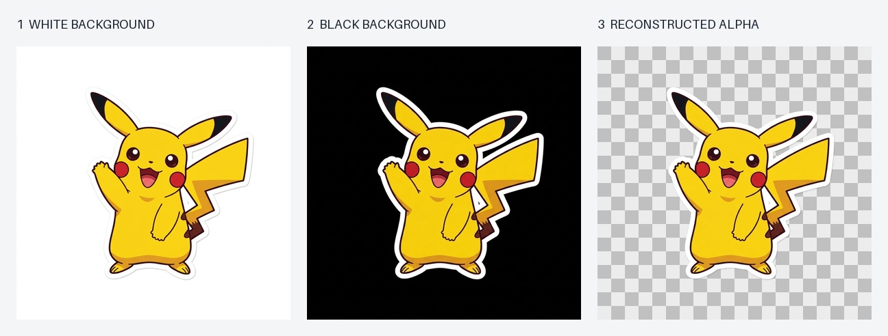

# Gemini Batch Transparent PNG

Generate transparent-background PNG images at scale using Google's official Gemini Batch API.



**Real Gemini example:** Pikachu generated with `gemini-nano-banana-2.1`, then edited onto black and reconstructed into an RGBA PNG. The white sticker outline remains part of the foreground. The checkerboard appears only in the preview; the PNG has an actual alpha channel.

[White source](docs/images/white.png) · [Black source](docs/images/black.png) · [Transparent PNG](docs/images/transparent.png)

## Measured Cost

A real-world run tested on **October 22, 2026** produced approximately **950 transparent PNGs**. The API usage total, including repair requests, was **$41.29 USD**.

| Measurement | Result |
| --- | --- |
| Test date | October 22, 2026 |
| Transparent images | Approximately 950 |
| Total API cost, including repairs | **$41.29** |
| Average cost per transparent image | **Approximately $0.0435 (4.35 cents)** |

The average is calculated as $41.29 ÷ approximately 950 images. This is the observed cost of that run, not a fixed per-image price; model, resolution, retries, and API pricing affect other runs. The README demonstration above was generated separately.

## Features

- Two-stage image generation through the official Gemini Batch API
- Alpha reconstruction from paired white/black images
- TSV prompt import and automatic file naming
- Saved job state, interrupted-job recovery, and bounded retries
- Background validation and failure reports
- Resumable downloads of large Batch result files
- Automatic checkerboard contact sheets after each black-background batch
- Advisory quality reports for interior white patches, edge residue, and inconsistent pairs
- Local repair, regeneration, and selective acceptance of corrected images
- Offline tests and GitHub Actions for Linux and macOS

## How It Works

1. Generate an image against a pure white background.
2. Edit it to use a pure black background while preserving the foreground.
3. Compare the pair to estimate the alpha channel and foreground color.
4. Save an RGBA PNG and generate checkerboard review sheets.

The batch generator uses Google's [Batch API](https://ai.google.dev/gemini-api/docs/batch-api). The default model is `gemini-nano-banana-2.1`; check the official [image generation documentation](https://ai.google.dev/gemini-api/docs/image-generation) for model availability.

## Installation

Requires **Python 3.10+** on macOS or Linux. Windows users can use WSL.

```bash
python3 -m venv .venv
source .venv/bin/activate
python3 -m pip install -r requirements.txt
```

Set your API key from [Google AI Studio](https://aistudio.google.com/apikey):

```bash
export GEMINI_API_KEY="YOUR_API_KEY"
```

The programs read the environment variable; they do not automatically load `.env` files.

## Input Format

Use a UTF-8 TSV with three tab-separated columns:

| ID | Name | Prompt |
| --- | --- | --- |
| demo_01 | Pikachu | A cheerful full-body Pikachu waving one paw... |
| demo_02 | Toy robot | A friendly blue tin toy robot with a round head... |
| demo_03 | Astronaut | A small cheerful astronaut floating with one hand raised... |
| demo_04 | Tea cup | A coral-red ceramic tea cup with a large open handle... |

[example.tsv](example.tsv) contains the complete prompts. An optional header begins with `ID`. IDs must be unique and contain only ASCII letters, digits, underscores, or hyphens. The first column determines the filename, such as `demo_01.png`. Prompts must not be empty.

## Batch Generation

```bash
python3 batch_transparent.py example.tsv --batch-size 20
```

Transparent images are saved to `output/transparent/`. To resume, rerun the same command with the same input, model, resolution, and output directory. Preserve `output/_work/`; interrupting the local process does not cancel an already submitted server-side job.

```bash
python3 batch_transparent.py example.tsv --out output_demo --size 2K --limit 2 --batch-size 20
```

| Option | Default | Description |
| --- | --- | --- |
| `--out` | `output` | Output directory |
| `--model` | `gemini-nano-banana-2.1` | Gemini image model |
| `--size` | `1K` | `1K`, `2K`, or `4K` |
| `--batch-size` | `100` | Requests per batch, from 1 to 100 |
| `--max-attempts` | `3` | Generation attempts per image per stage |
| `--limit` | All records | Process only the first N records |
| `--review-only` | Off | Rebuild review sheets without API calls or credentials |
| `--confirm-not-created` | Off | Allow resubmission after manually confirming that an uncertain job was never created |

Failed or invalid images are retried up to the attempt limit. Quota errors pause the run and preserve successful results. Rerun after fixing the quota or network issue; increase `--max-attempts` to give exhausted requests another attempt. If submission is uncertain, inspect the server-side job list before using `--confirm-not-created`.

Changing a prompt, model, or resolution requires a new output directory. The program locks output directories to prevent concurrent writers.

```text
output/
├── white/           # White-background images
├── black/           # Black-background edits
├── transparent/     # Final RGBA PNGs
├── review/          # Contact sheets and quality reports
├── _work/           # State, requests, downloads, and rejected images
└── failures.tsv     # Remaining IDs, attempts, and errors
```

## Visual Quality Review

Each processed black-background batch produces `review/batch-<token>-001.jpg` and a matching TSV. Sheets contain up to 16 labeled thumbnails per page; larger batches produce additional pages. Missing and unreadable outputs remain visible as labeled entries. `review/overview-001.jpg` and `review/overview.tsv` summarize the requested IDs when a run finishes or pauses.

Rebuild the overview from existing output without a key or API charges:

```bash
python3 batch_transparent.py example.tsv --out output --review-only
```

The quality report measures:

- **Near-white opaque pixels**, including possible unedited background holes inside the subject.
- **Nontransparent canvas edges**, which may indicate cropping or background residue.
- **Inconsistent color differences between the pair**, which may indicate foreground changes.

These are review hints. A white suit, reflection, or sticker outline can legitimately trigger a flag. Flags never remove images or trigger paid retries. Corner and edge checks cannot reliably distinguish every interior background patch from foreground detail; inspect the sheets before accepting a large batch.

## Repair Selected Images

`repair.py` accepts any valid IDs and keeps repair candidates separate from accepted images.

Reconstruct transparency from existing white/black pairs without API calls:

```bash
python3 repair.py local demo_01 demo_02
```

Inspect `output_repair/local_preview/` or the contact sheets in `output_repair/review/`, then accept a candidate:

```bash
python3 repair.py accept local demo_01
```

If the black-background edit is unsuitable, regenerate it with a stricter prompt. This command calls the API:

```bash
python3 repair.py regen demo_01 --tsv example.tsv
```

Rerun the same command to resume. Model and resolution are inherited from the repair task, then from the source task, unless supplied with `--model` and `--size`. Existing completed candidates are reused. To reject an attempt and generate another:

```bash
python3 repair.py retry demo_01
python3 repair.py regen demo_01 --tsv example.tsv
python3 repair.py accept regen demo_01
```

Inspect `output_repair/regen_preview/` before accepting. `retry` backs up rejected candidates and resets attempts; it does not call the API itself.

All repair subcommands accept `--source` and `--repair` after the subcommand:

```bash
python3 repair.py local demo_01 --source output_demo --repair output_demo_repair
```

Use the same directories for subsequent commands. They must be separate and must not be nested. Accepted candidates replace files in the source `transparent/` directory; originals are backed up under `_work/quality_backup/`. Rejected candidates and state are backed up under the repair directory's `_work/manual_rejections/`.

## Reproduce the README Example

The committed example was produced from `demo_01` in `example.tsv` using this command:

```bash
python3 scripts/generate_demo.py --id demo_01 --out output_demo --publish-to docs/images
```

The demo makes **two synchronous Gemini requests** using the same prompt transformation, black-background edit, and alpha reconstruction as the Batch workflow. It incurs standard synchronous API charges and retains intermediate images for reuse. If no environment key is set, an interactive terminal can enter it at a hidden prompt; it is not saved.

To export an already completed Batch result without additional API calls:

```bash
python3 scripts/generate_demo.py --id demo_01 --from-output output --publish-to docs/images
```

The exporter saves the white source, black source, actual transparent PNG, and labeled comparison image. Choose a new `--out` directory if you change the demo prompt or model.

## Tests

```bash
python3 -m unittest discover -s tests -v
```

Tests use synthetic images, temporary directories, and an in-memory Gemini API fake. Network connections are blocked by the test fixtures. No credentials or paid API requests are needed.

Coverage includes TSV validation, known alpha/color reconstruction, background validation, uncertain submissions, saved-job recovery, quota pauses, bounded failure retries, repair backups, locking, quality flags, and contact-sheet pagination.

[GitHub Actions](.github/workflows/tests.yml) runs the suite on pushes and pull requests, across Python 3.10–3.13 on Ubuntu and macOS.

## Project Structure

```text
gemini-batch-transparent-png/
├── batch_transparent.py
├── repair.py
├── review.py
├── example.tsv
├── requirements.txt
├── tests/                    # Offline unit and workflow tests
├── .github/workflows/        # CI configuration
├── scripts/generate_demo.py  # Reproducible README example
├── docs/images/              # Public demonstration images
├── README.md
├── .gitignore
└── LICENSE
```

## Limitations

- Image generation requires a Gemini API key and applicable quota.
- A new image normally requires two generation requests; retries add requests and charges.
- Gemini may change foreground details during background replacement. Reconstruction assumes the pair is aligned and its foreground is unchanged.
- Quality flags and previews assist review but cannot guarantee perfect transparency.

## Publishing

The `.gitignore` allowlists source code, tests, CI, documentation, and the four reviewed demo images. Other prompt lists, outputs, credentials, environments, and Batch state are excluded. Add an explicit exception when intentionally publishing a new file.

Git ignore rules do not filter files dragged into GitHub's web upload interface. Upload only the project files listed above. Never include a local key or an output directory.

## Acknowledgments

Inspired by Jide's article on generating transparent background images with Nano Banana Pro.

## License

[MIT License](LICENSE).
